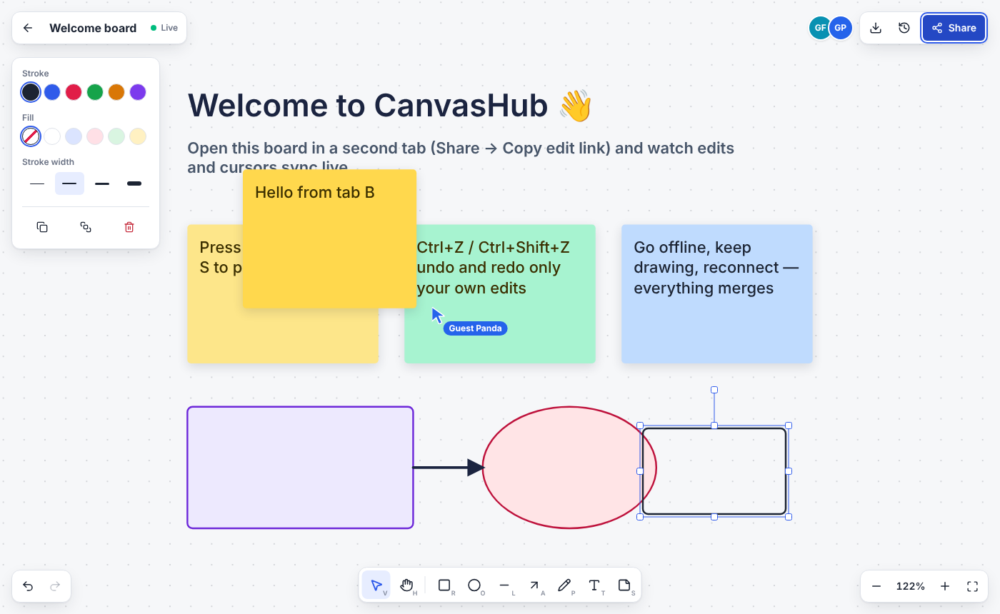
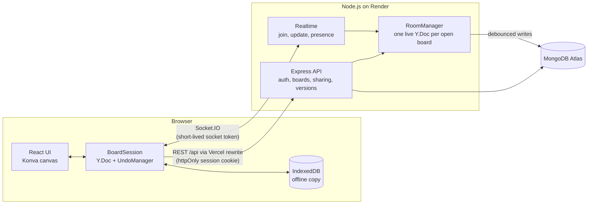

# CanvasHub — collaborative multi-user canvas

A shared whiteboard where several people draw, write sticky notes and move things around **at the same time**, see each other's cursors live, and keep working **offline** — changes merge automatically when they reconnect.

**Live demo:** _coming soon_ · click **“Try a board — no sign-up”**, then **Share → Copy link** and open it in a second tab or on your phone.

> The API runs on a free host that sleeps when idle, so the first visit can take up to a minute to wake it. The page shows a progress message while that happens.



## What it does

| | |
|---|---|
| **Real-time editing** | Rectangles, ellipses, lines, arrows, freehand pen, text and sticky notes. Moves, resizes and text edits reach everyone on the board while they happen. |
| **Live presence** | Named, coloured cursors for every collaborator, avatars in the header, and a dashed outline around whatever each person has selected. |
| **Offline-first** | Edits are saved in IndexedDB and kept in the shared document while you're offline. On reconnect the client and server exchange Yjs state vectors and send each other only what's missing. |
| **Undo your own work** | Undo/redo is scoped to your own changes — it never reverts what someone else just did. |
| **Sharing** | Separate *edit* and *view-only* links. The owner can reset them to lock out old links. Viewers are blocked on the server, not just hidden in the UI. |
| **Versions** | Name a snapshot, restore it later as one undoable change everyone sees. |
| **Export** | Download the whole board (not just the visible part) as a PNG. |
| **Infinite canvas** | Pan (hand tool, space-drag, trackpad), zoom around the cursor (Ctrl/⌘ + wheel, pinch), fit to content. |

Keyboard: `V` select · `H` pan · `R` `O` `L` `A` `P` `T` `S` tools · `Del` delete · `Ctrl+Z` / `Ctrl+Shift+Z` · `Ctrl+D` duplicate · `Ctrl+A` select all · arrows nudge · `Shift+1` fit.

## Tech stack

**Frontend:** React 19, TypeScript, Vite, Konva / react-konva (canvas rendering), Yjs (CRDT), y-indexeddb, Socket.IO client, Zustand, React Router, Tailwind CSS 4, Vitest + Testing Library, Playwright.
**Backend:** Node.js, Express 5, Socket.IO, Yjs, MongoDB + Mongoose, JWT (httpOnly cookie), bcrypt, Zod, Helmet, express-rate-limit.
**Infra:** Vercel (web app), Render (API + WebSockets), MongoDB Atlas, GitHub Actions CI.

## Architecture



### How sync works

Each board is a **Yjs document** containing one `Y.Map` of shapes. Yjs updates are commutative and idempotent, so the order and duplication of network messages doesn't matter and concurrent edits converge on every client.

1. **Join:** the client sends its *state vector* (a summary of what it already has).
2. The server replies with exactly the updates the client is missing, plus its own state vector.
3. The client sends back anything the server is missing — i.e. edits made while offline.
4. After that, local changes are **batched every 30 ms** (one message per frame of a drag, not one per mouse event) and fanned out to the room.

On the server, a `RoomManager` keeps one live `Y.Doc` per open board, applies updates in memory, and writes to MongoDB after **1.5 s of quiet** — a 20-edit burst becomes a single database write (covered by a test). Boards are flushed on the last disconnect and on `SIGTERM`, so deploys don't lose work.

### Security decisions

- Session JWT in an **httpOnly, SameSite=Lax cookie**; the web app reaches the API through a same-origin Vercel rewrite, so no cross-site cookies are needed.
- WebSockets authenticate with a separate **5-minute socket token** (aud `socket`), since browsers can't attach cross-site cookies to the socket host.
- **Server-enforced roles:** viewers' updates are rejected with `READ_ONLY`; boards you can't access return **404**, so ids can't be probed.
- Presence names and colours are assigned **by the server**, so a client can't impersonate someone.
- Login errors don't reveal whether an email exists; bcrypt-hashed passwords; Zod-validated input; one JSON error shape with no stack traces; per-IP auth rate limit and a per-socket update token bucket (60/s).
- Post-login redirects accept same-site paths only (`//evil.com` and `/\evil.com` are rejected).

## Measured

| What | Result | How |
|---|---|---|
| Server fan-out latency, 1 sender → 9 collaborators | **p50 1.2 ms, p95 2.7 ms, p99 4.4 ms** (300 edits, all clients converged) | `npm run bench` in `server/` (local, excludes internet latency) |
| Database writes for a 20-edit burst | **1** | `realtime.test.ts` |
| Landing page JS (gzip) | **88 kB**; canvas engine (105 kB) and sync (38 kB) load only when a board opens | `vite build` |
| Automated tests | **20 server + 20 client unit + 7 end-to-end** | see below |

## Tests

```bash
cd server && npm test        # API, auth, sharing, versions, realtime sync, offline merge, persistence (Vitest + Supertest + socket.io-client)
cd client && npm test        # geometry, shape helpers, undo scoping, version restore, redirect safety, toolbar a11y
cd client && npm run test:e2e  # Playwright: two real browsers editing live, offline then reconnect, view-only enforcement, versions, PNG export
```

The store contract tests run against the in-memory store locally and against a **real MongoDB** service container in CI.

## Run it locally

```bash
# API (in-memory store; set STORE=mongo + MONGODB_URI to use MongoDB)
cd server && npm install && npm run dev        # http://localhost:4000

# Web app (proxies /api and /socket.io to :4000)
cd client && npm install && npm run dev        # http://localhost:5173
```

## Deploy

- **API → Render:** `render.yaml` is a Blueprint (root `server/`, health check `/api/health`). Set `MONGODB_URI` (MongoDB Atlas) and `CLIENT_ORIGIN` (your Vercel URL) in the dashboard; `JWT_SECRET` is generated.
- **Web app → Vercel:** root `client/`. `client/vercel.json` rewrites `/api/*` to the Render URL and falls back to `index.html`. Set `VITE_SOCKET_URL` to the Render URL (here `https://canvashub-api.onrender.com`).

## Known limitations

- Shapes are last-writer-wins per object: if two people resize the same rectangle at the same instant, one resize wins (no data is lost elsewhere).
- Text inside a single note isn't character-merged; it would need a `Y.Text` per note.
- Touch devices can draw and pan; two-finger pinch-zoom on the canvas isn't implemented yet (use the zoom buttons).
- The offline copy is per browser. Clearing site data removes edits that never reached the server.

## Project structure

```
client/   React app (pages, editor components, BoardSession sync client, Playwright e2e)
server/   Express + Socket.IO server (auth, boards, rooms, Mongo/memory stores, tests, latency bench)
docs/     screenshots
```
